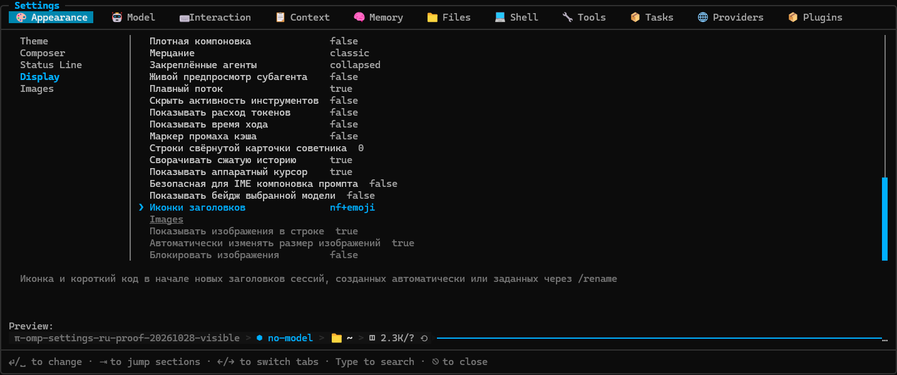

# omp-settings-ru

[](LICENSE) [](https://github.com/narimanisakhanov-creator/omp-settings-ru/releases)

русский перевод штатной панели `/settings` в [Oh My Pi](https://github.com/can1357/oh-my-pi).
отдельное расширение — не форк OMP и не патч `omp.exe`.

переводит названия, описания, предупреждения и статические подписи вариантов.
значения, пути, идентификаторы моделей и обработчики не меняются.
вкладки, группы, динамические списки и остальная TUI остаются у хоста.



[о снимке](docs/screenshots.md).

## установка

один штатный путь — marketplace OMP с каталогом из выпуска; не добавляй вторую копию через `-e`, `--plugin-dir` или settings extensions.

```text
omp plugin marketplace add https://github.com/narimanisakhanov-creator/omp-settings-ru/releases/latest/download/marketplace.json
omp plugin install omp-settings-ru@omp-settings-ru
```

**внимание:** следующая команда включает общий режим `marketplace.autoUpdate=auto` для **всех** marketplace-плагинов пользователя и активного проекта, не только для перевода.

```text
omp config set marketplace.autoUpdate auto
```

после установки нужна новая сессия. плагин не меняет конфиг сам, а его runtime по-прежнему не ходит в сеть.

каталог закрепляет release commit полным `source.sha` и тегом `source.ref`; архив и `SHA256SUMS` лежат в том же выпуске. отдельной ветки каталога нет. `private:true`, `omp.extensions` и `npm pack` — упаковка и происхождение релиза, а не второй способ установки; запуск `-e` из checkout — только разработка.

### переход со старого каталога

старый URL каталога (`raw.githubusercontent.com/.../marketplace/...`) больше не обслуживается. повторное `marketplace add` того же имени с новым URL отклоняется — сначала убери старое имя, затем добавь новое; состояние плагина сохраняется:

```text
omp plugin marketplace remove omp-settings-ru
omp plugin marketplace add https://github.com/narimanisakhanov-creator/omp-settings-ru/releases/latest/download/marketplace.json
omp plugin marketplace update omp-settings-ru
```

не удаляй плагин ради перехода: `uninstall` стирает собственные plugin settings/features, а `remove` каталога их сохраняет.

legacy npm-managed GitHub-установка больше не поддерживается и не документируется как способ установки. одноразовый state-preserving переход из одной legacy npm user-установки описан в [CONTRIBUTING](CONTRIBUTING.md#переход-на-marketplace); обратный переход на npm отклоняется.

## язык и удаление

команды вводятся из основного промпта, не из поиска панели:

- `/settings-language ru` — русский;
- `/settings-language en` — исходный английский;
- `/settings-language` — выбор языка.

после переключения закрой и заново открой `/settings`.
язык относится к текущей сессии и не записывается в конфиг.
следующая основная сессия с плагином начинает с русского.

для возврата в текущей сессии сначала `/settings-language en`, затем удали плагин:

```text
omp plugin uninstall omp-settings-ru@omp-settings-ru
```

новая сессия без плагина использует исходные тексты; если использовались explicit extension roots, убери их тоже.

uninstall удаляет собственные plugin settings/features. для отключения без потери state — `omp plugin disable omp-settings-ru@omp-settings-ru`; обратный переход на npm не поддерживается.

## обновление

`notify` — штатный режим без установки; `off` — без проверки; `auto` — установка обновлений на старте, когда каталог устарел. **это общая настройка OMP для всех marketplace-плагинов пользователя и активного проекта, не только перевода.**

в прочитанном OMP 18.8.7 каталог обновляется после 24 часов, а ошибки startup updater хост подавляет: `auto` не проверяет обновления при каждом запуске и не гарантирует установку при сетевой ошибке. настройку задаёт только пользователь — плагин не меняет конфиг сам.

```text
omp config get marketplace.autoUpdate
omp config set marketplace.autoUpdate auto
```

немедленная проверка — отдельный шаг, затем новая сессия:

```text
omp plugin marketplace update omp-settings-ru
omp plugin upgrade omp-settings-ru@omp-settings-ru
```

`auto` не проходит собственный release gate проекта; [SECURITY](SECURITY.md) описывает границы.

<!-- omp-supported:start -->
## поддерживаемые версии OMP

Поддержка в этом checkout: OMP 18.6.1, 18.8.0, 18.8.4, 18.8.7, 18.12.6, 18.13.1.

| OMP | Windows | Linux | macOS |
| --- | ---: | ---: | ---: |
| 18.6.1 | 398/398 | 398/398 | 398/398 |
| 18.8.0 | 404/404 | 404/404 | 404/404 |
| 18.8.4 | 404/404 | 404/404 | 404/404 |
| 18.8.7 | 410/410 | 410/410 | 410/410 |
| 18.12.6 | 419/419 | 419/419 | 419/419 |
| 18.13.1 | 421/421 | 421/421 | 421/421 |

в ячейке — измеренное покрытие каталога для точной пары «версия × платформа» (`bun scripts/check-coverage.ts <версия> <платформа>`); другое число в ячейке означает другое измерение, а не округление.
список относится к текущему checkout: совместимость опубликованного пакета определяется тегом его выпуска, а не этим файлом.
источники — [манифест поддержанных хостов](test/fixtures/host-snapshots/supported-hosts.json) и exact-commit CI [check.yml](.github/workflows/check.yml); покрытие платформы, отличной от раннера, выведено из источника пакета и нативную панель не доказывает.

неизвестный путь или изменившийся источник остаётся английским; неизвестная версия не становится поддержанной от совпадения строк. определения уровней доказательств — в [CONTRIBUTING](CONTRIBUTING.md#матрица-и-peer-диапазон).
<!-- omp-supported:end -->

## подробнее

[FAQ](docs/faq.md) · [глоссарий](docs/glossary.md) · [архитектура](docs/architecture.md) · [сопровождение](CONTRIBUTING.md) · [изменения](CHANGELOG.md) · [безопасность](SECURITY.md).

[MIT](LICENSE).
[ошибки и предложения](https://github.com/narimanisakhanov-creator/omp-settings-ru/issues) · [нормы поведения](CODE_OF_CONDUCT.md).
