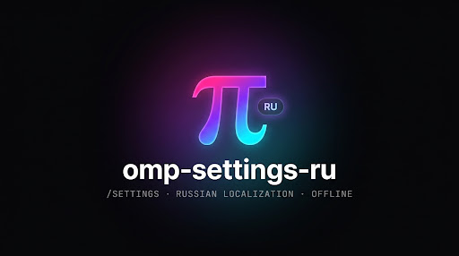
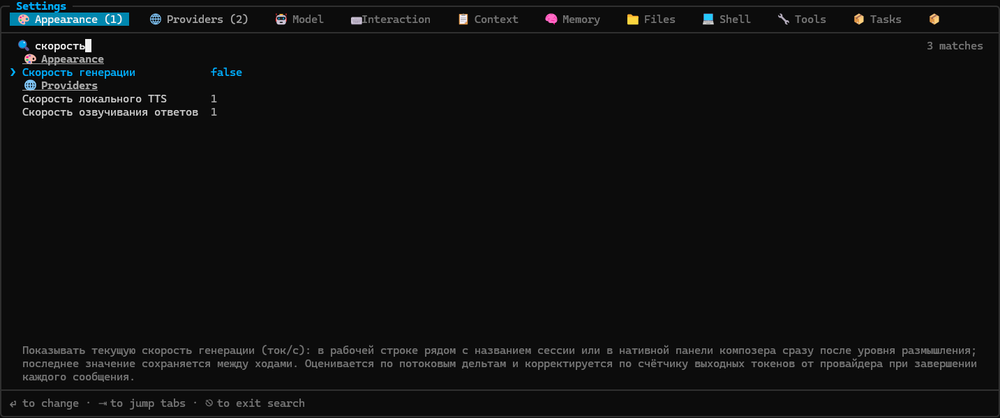
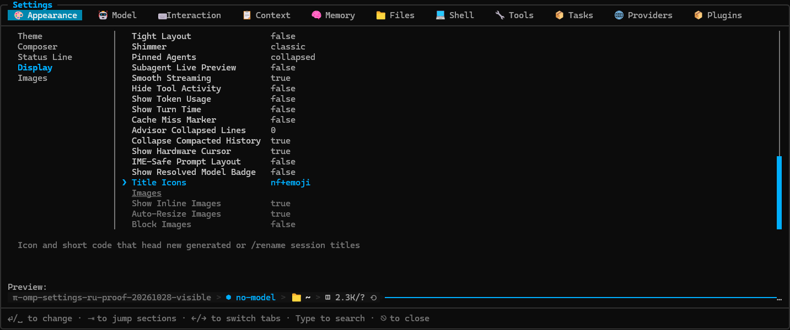

<div align="center">



<br>

<p>
  <a href="https://github.com/narimanisakhanov-creator/omp-settings-ru/releases/latest"></a>
  <a href="https://github.com/narimanisakhanov-creator/omp-settings-ru/actions/workflows/check.yml?query=branch%3Amain"></a>
  <!-- omp-badges:start -->

<!-- omp-badges:end -->
  <a href="LICENSE"></a>
</p>

<p>
  
  
  <!-- omp-coverage:start -->

<!-- omp-coverage:end -->
  
</p>

<p>
  <b>Русская панель <code>/settings</code> для <a href="https://github.com/can1357/oh-my-pi">Oh My Pi</a>: отдельное marketplace-расширение, не форк OMP и не патч <code>omp.exe</code>.</b><br>
  🧩 переводит UI · 🔒 не меняет значения и обработчики · 🌐 работает офлайн в runtime
</p>

<p>
  <a href="#%D1%83%D1%81%D1%82%D0%B0%D0%BD%D0%BE%D0%B2%D0%BA%D0%B0">Установка</a> ·
  <a href="#%D0%BF%D0%BE%D0%B4%D0%B4%D0%B5%D1%80%D0%B6%D0%B8%D0%B2%D0%B0%D0%B5%D0%BC%D1%8B%D0%B5-%D0%B2%D0%B5%D1%80%D1%81%D0%B8%D0%B8-omp">Совместимость</a> ·
  <a href="docs/screenshots.md">Скриншоты</a> ·
  <a href="CHANGELOG.md">Изменения</a> ·
  <a href="https://github.com/narimanisakhanov-creator/omp-settings-ru/issues">Сообщить об ошибке</a>
</p>

</div>

---


[О снимке и его происхождении](docs/screenshots.md).

Плагин переводит названия, описания, предупреждения и статические подписи вариантов. Значения, пути, идентификаторы моделей и обработчики не меняются; вкладки, группы, динамические списки и остальная TUI остаются у хоста.

<details>
<summary>Поиск и английское сравнение</summary>





</details>

## Установка

Штатный путь один — marketplace OMP с каталогом из выпуска:

```text
omp plugin marketplace add https://github.com/narimanisakhanov-creator/omp-settings-ru/releases/latest/download/marketplace.json
omp plugin install omp-settings-ru@omp-settings-ru
```

<details>
<summary>Технические детали сборки и безопасности</summary>

Не добавляй вторую копию через `-e`, `--plugin-dir` или расширения, прописанные в настройках.

Каталог закрепляет коммит выпуска полным `source.sha` и тегом `source.ref`; архив и `SHA256SUMS` лежат в том же выпуске. Отдельной ветки каталога нет. `private:true`, `omp.extensions` и `npm pack` относятся к упаковке и происхождению релиза, а не являются вторым способом установки; запуск `-e` из рабочей копии репозитория нужен только для разработки.

</details>

> [!WARNING]
> Следующая команда — `omp config set marketplace.autoUpdate auto` — включает общий режим `marketplace.autoUpdate=auto` для **всех** marketplace-плагинов пользователя и активного проекта, а не только для перевода.

После установки начни новую сессию. Плагин не меняет конфигурацию сам, а при работе по-прежнему не обращается к сети.

### Переход со старого каталога

Старый URL каталога (`raw.githubusercontent.com/.../marketplace/...`) больше не обслуживается. Повторное `marketplace add` того же имени с новым URL будет отклонено: сначала удали старое имя, затем добавь новое. Состояние плагина сохранится:

```text
omp plugin marketplace remove omp-settings-ru
omp plugin marketplace add https://github.com/narimanisakhanov-creator/omp-settings-ru/releases/latest/download/marketplace.json
omp plugin marketplace update omp-settings-ru
```

> [!WARNING]
> Не удаляй плагин ради перехода: `uninstall` стирает собственные настройки и функции плагина, а `remove` каталога их сохраняет.

Старая установка через npm из GitHub больше не поддерживается и не описывается как способ установки. Одноразовый переход из одной прежней пользовательской установки через npm, без потери состояния, описан в [CONTRIBUTING](CONTRIBUTING.md#переход-на-marketplace); обратный переход на npm отклоняется.

## Язык и удаление

Команды вводятся из основного промпта, а не из поиска панели:

- `/settings-language ru` — русский;
- `/settings-language en` — исходный английский;
- `/settings-language` — выбор языка.

После переключения закрой и заново открой `/settings`. Язык относится к текущей сессии и не записывается в конфигурацию. Следующая основная сессия с плагином начинает с русского.

Для возврата в текущей сессии сначала выполни `/settings-language en`, затем удали плагин:

```text
omp plugin uninstall omp-settings-ru@omp-settings-ru
```

Новая сессия без плагина использует исходные тексты; если задавал явные каталоги расширений, убери и их.

`uninstall` удаляет собственные настройки и функции плагина. Чтобы отключить плагин без потери состояния, выполни `omp plugin disable omp-settings-ru@omp-settings-ru`; обратный переход на npm не поддерживается.

## Обновление

`notify` — штатный режим без установки; `off` — без проверки; `auto` — установка обновлений на старте, когда каталог устарел. **Это общая настройка OMP для всех marketplace-плагинов пользователя и активного проекта, а не только для перевода.**

По результатам анализа исходного кода OMP 18.8.7 каталог обновляется после 24 часов, а ошибки обновлятора при запуске (startup updater) хост подавляет: `auto` не проверяет обновления при каждом запуске и не гарантирует установку при сетевой ошибке. Настройку задаёт только пользователь — плагин не меняет конфигурацию сам.

```text
omp config get marketplace.autoUpdate
omp config set marketplace.autoUpdate auto
```

Немедленная проверка — отдельный шаг, затем новая сессия:

```text
omp plugin marketplace update omp-settings-ru
omp plugin upgrade omp-settings-ru@omp-settings-ru
```

`auto` не проходит собственный release gate проекта; [SECURITY](SECURITY.md) описывает границы.

<!-- omp-supported:start -->
## Поддерживаемые версии OMP

Поддержка в этой копии репозитория: OMP 18.14.1, 18.14.2, 18.15.0.

Целевое окно — три последние стабильные npm-версии OMP. Новые версии проходят проверки и добавляются последовательно; таблица показывает только уже измеренную поддержку, а не будущую очередь.

| OMP | Windows | Linux | macOS |
| --- | ---: | ---: | ---: |
| 18.14.1 | 433/433 | 433/433 | 433/433 |
| 18.14.2 | 435/435 | 435/435 | 435/435 |
| 18.15.0 | 435/435 | 435/435 | 435/435 |

В ячейке — измеренное покрытие каталога для точной пары «версия × платформа» (`bun scripts/check-coverage.ts <версия> <платформа>`); другое число в ячейке означает другое измерение, а не округление.
Список относится к текущей копии репозитория: совместимость опубликованного пакета определяется тегом его выпуска, а не этим файлом.
Источники — [манифест поддержанных хостов](test/fixtures/host-snapshots/supported-hosts.json) и CI на точный коммит [check.yml](.github/workflows/check.yml). Для платформ, которых нет на CI-раннере, покрытие проверяется статически по исходникам пакета (без запуска нативной панели TUI).

Если версия OMP не входит в список проверенных, плагин не гарантирует полную совместимость, даже при частичном совпадении строк. Неизвестный путь или изменившийся источник остаётся английским. Определения уровней доказательств — в [CONTRIBUTING](CONTRIBUTING.md#матрица-и-peer-диапазон).
<!-- omp-supported:end -->

## Подробнее

[FAQ](docs/faq.md) · [Глоссарий](docs/glossary.md) · [Архитектура](docs/architecture.md) · [Сопровождение](CONTRIBUTING.md) · [Изменения](CHANGELOG.md) · [Безопасность](SECURITY.md).

[MIT](LICENSE).
[Ошибки и предложения](https://github.com/narimanisakhanov-creator/omp-settings-ru/issues) · [Нормы поведения](CODE_OF_CONDUCT.md).
